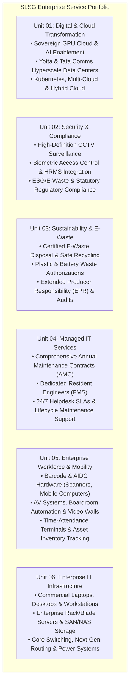
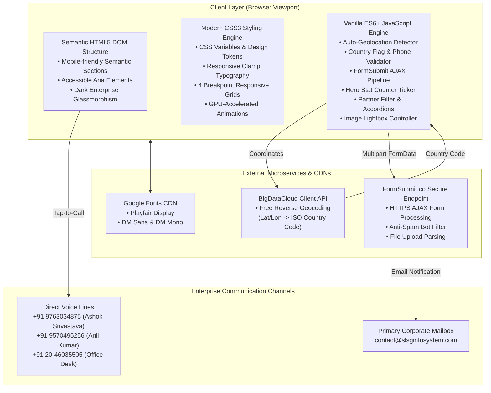
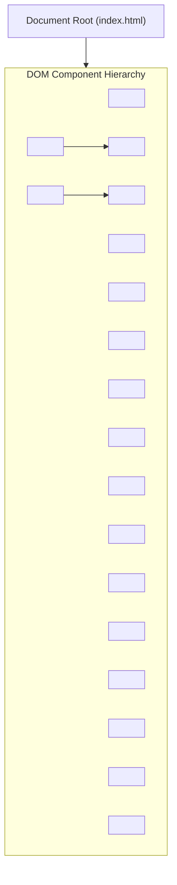
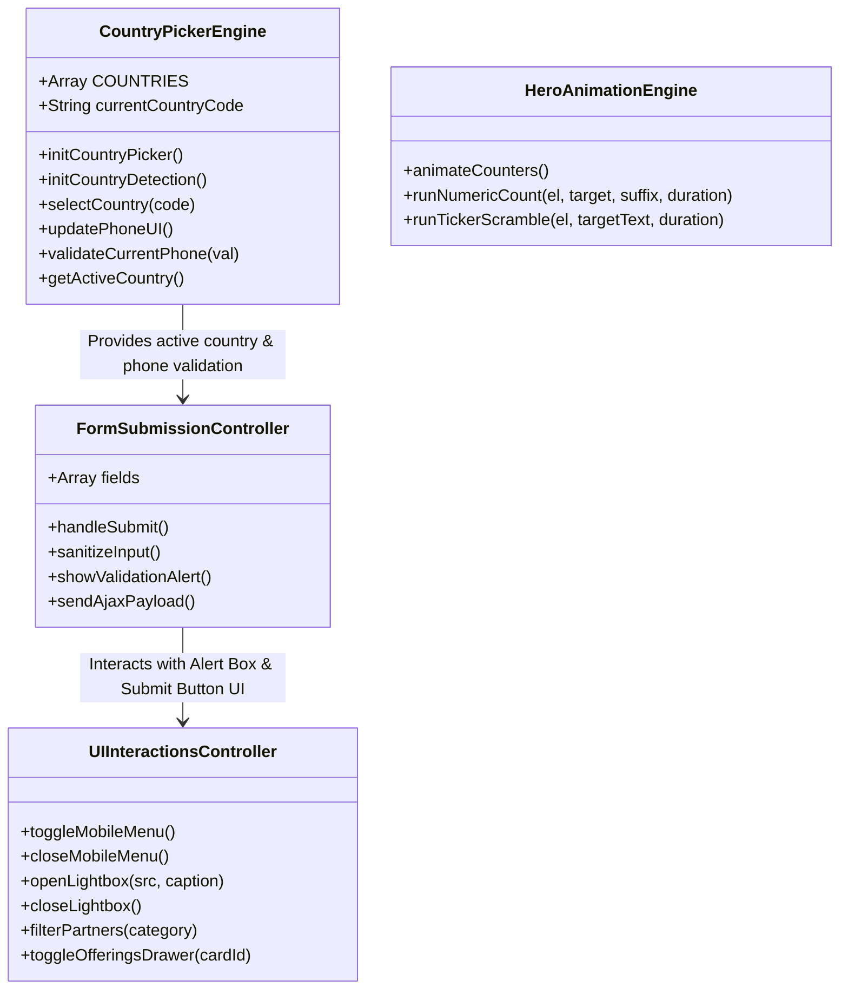
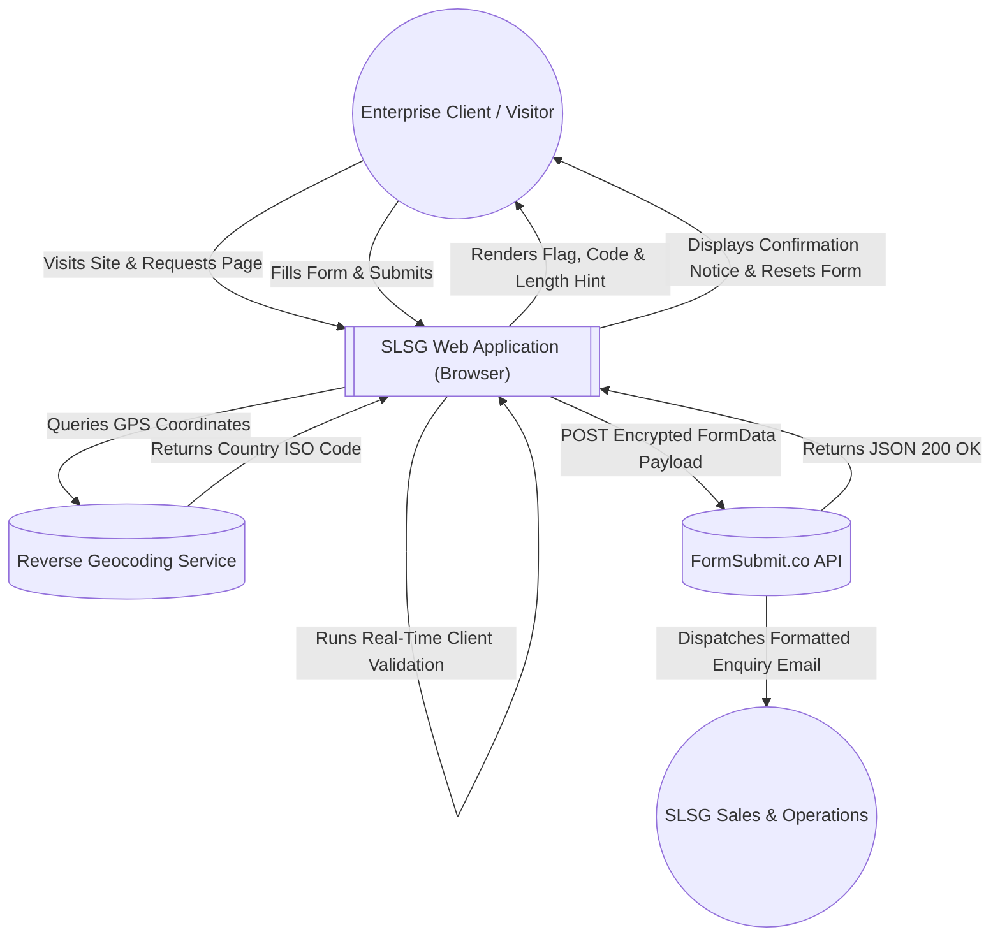
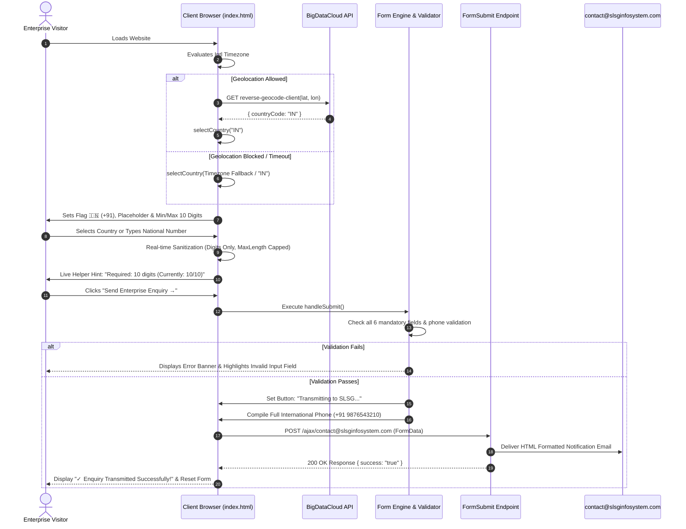
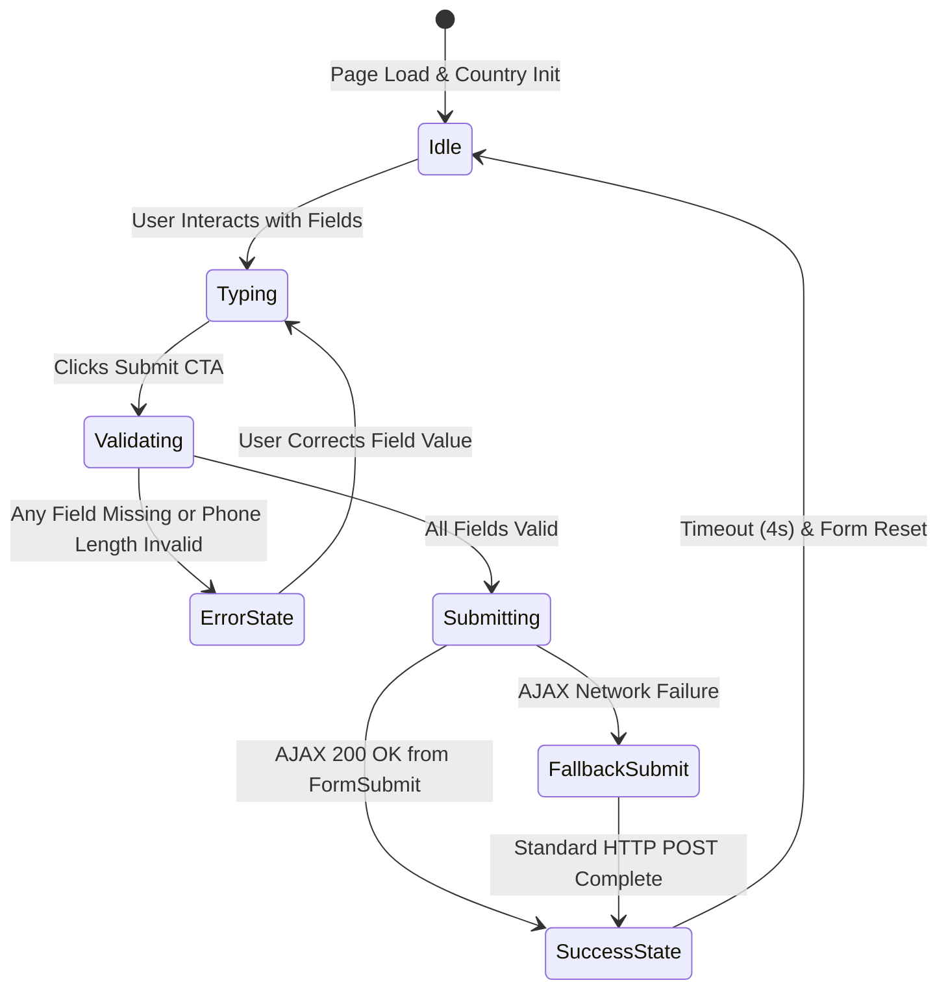
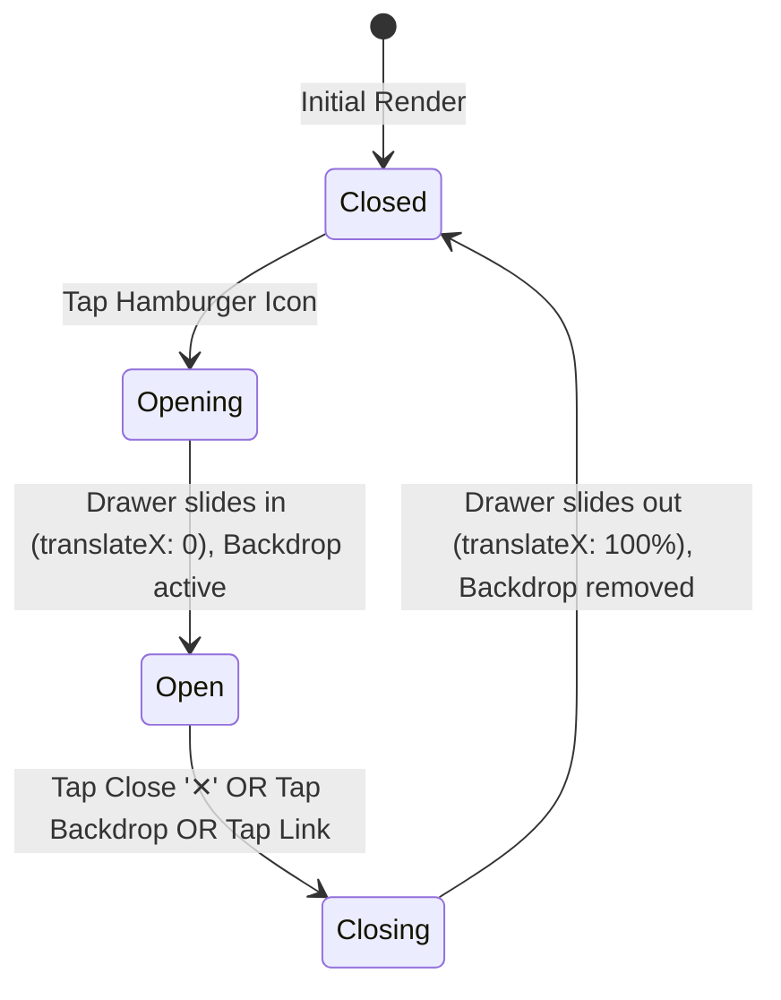

# SLSG Infosystems — Enterprise Technology & Business Transformation Website

> **Official Enterprise Portal for SLSG Infosystems Pvt. Ltd.**  
> *Winner — Emerging Enterprise of the Year 2026 (Global RISE Awards by SMB Connect in association with DCCIA Pune)*  
> Corporate Web Platform: [https://slsginfosystem.com](https://slsginfosystem.com) | Contact: `contact@slsginfosystem.com`

---

## Table of Contents

1. [Executive Summary & Purpose](#1-executive-summary--purpose)
2. [Complete Website Features & Capabilities](#2-complete-website-features--capabilities)
3. [Core Business Portfolios & Partner Ecosystem](#3-core-business-portfolios--partner-ecosystem)
4. [High-Level Architecture (HLD)](#4-high-level-architecture-hld)
5. [Low-Level Architecture & Component Design (LLD)](#5-low-level-architecture--component-design-lld)
6. [Data Flow & Sequence Diagrams](#6-data-flow--sequence-diagrams)
7. [State Machine Diagrams](#7-state-machine-diagrams)
8. [Interactive Features & Technical Implementation](#8-interactive-features--technical-implementation)
9. [Design System & Responsive UI Engineering](#9-design-system--responsive-ui-engineering)
10. [Repository Directory Structure](#10-repository-directory-structure)
11. [Deployment, Local Setup & Form Activation](#11-deployment-local-setup--form-activation)
12. [Evolution & Enhancement History](#12-evolution--enhancement-history)
13. [SEO Architecture & Search Engine Optimization Guide](#13-seo-architecture--search-engine-optimization-guide)

---

## 1. Executive Summary & Purpose

The **SLSG Infosystems Website** is a high-performance, responsive single-page enterprise web application engineered to articulate the company's full-spectrum technological offerings, executive leadership, institutional credibility, global technology alliances, and nationwide delivery capabilities.

### Key Business Identity
- **Legal Entity**: SLSG Infosystems Pvt. Ltd.
- **Accolade**: Conferred with the **Emerging Enterprise of the Year 2026** award by **SMB Connect** (The Rise) in association with the **Deccan Chamber of Commerce, Industries & Agriculture (DCCIA Pune)** on August 21, 2026, at Four Points by Sheraton, Pune.
- **Strategic Alliances**: Authorized service and distribution partners for top global OEMs, hyperscale cloud providers, and sustainability leaders including Tata Communications, Yotta, Staqo, SonicWall, Ingram Micro, Zebra Technologies, PeopleLink, Realtime Worldwide, and Techknowgreen Solutions Limited.
- **Presence**: Head Office in Kharadi, Pune (Downtown City Vista, near WTC) and Branch Office in Katraj, Pune, delivering solutions across Pan India.

---

## 2. Complete Website Features & Capabilities

```mermaid
flowchart LR
    subgraph BrandPresentation["Brand & Corporate Credibility"]
        Hero["Hero & Animated Metrics"]
        AwardStrip["Award Banner & Milestone Gallery"]
        Story["About SLSG & At a Glance"]
        Leadership["Executive Leadership & Messages"]
        Values["Vision, Mission & Core Values"]
    end

    subgraph SolutionsEcosystem["Solutions & Market Proof"]
        Services["6 Enterprise Business Units"]
        Framework["6-Step Delivery Framework"]
        Industries["6 Target Industry Verticals"]
        Partners["9 Technology Partners + Accordions"]
        Clients["20 Enterprise Billed Clients"]
    end

    subgraph UserAction["Engagement & Locations"]
        ContactForm["Enterprise Roadmap Form (AJAX)"]
        GeoPhone["Auto-Geo Flag & Phone Validation"]
        Locations["Head & Branch Office Locations"]
        Footer["Sitemap & Legal Links"]
    end

    BrandPresentation --> SolutionsEcosystem --> UserAction
```



### Comprehensive Section-by-Section Breakdown

| Section | Anchor ID | Purpose & Features | Key Interactions |
| :--- | :---: | :--- | :--- |
| **Sticky Navbar** | `#navbar` | Fixed luxury header with brand logo, primary sitemap links, direct call CTA, and mobile hamburger trigger. | Smooth scrolling, active navigation, mobile slide-out drawer with tap-outside dismiss. |
| **Hero Section** | `#home` | High-impact entry headline (*Powering India's Digital Future*), 2026 award badge, primary CTAs, and a 4-card metric grid. | Animated counter engine (`100%`, `360°`, `Pan India`, `Lifetime`). |
| **Award Banner** | — | Top ribbon celebrating the Global RISE Award by SMB Connect & DCCIA Pune. | Clickable shortcut jump to detailed award milestone. |
| **About Story & Glance** | `#about` | Corporate evolution, value creation narrative, and the "SLSG at a Glance" executive summary card. | Sticky summary panel on desktop, fluid inline stack on mobile. |
| **Vision & Mission** | `#vision-mission` | Corporate North Star: Sustainable digital acceleration, customer-first centricity, and scalable cloud-first infrastructure. | Luxury dark glassmorphism cards with gold accent borders. |
| **Core Values** | `#values` | 6 foundational pillars: *Integrity, Excellence, Innovation, Customer Centricity, Collaboration, Sustainability*. | Hover micro-interactions with gold gradient glows. |
| **Brand Promise & Quotes** | `#promise` | Corporate commitments and foundational philosophy: *"Human Intelligence, Powered by Technology"*. | High-contrast callout quotes with executive attribution. |
| **Leadership** | `#leadership` | Executive profiles for **Ashok Srivastava** (Founder & CEO) and **Anil Kumar** (COO, Indian Air Force Veteran). | Executive photo badges, career tags, and direct strategic messages. |
| **2026 Milestone & Gallery** | `#awards` | Comprehensive breakdown of the Emerging Enterprise award with 3 ceremony photographs. | Interactive lightbox modal with click-to-enlarge, backdrop blur, and touch dismiss. |
| **Why Choose SLSG** | `#why-us` | 6 enterprise differentiators: Pan-India reach, OEM partnerships, SLA-backed AMCs, and certified compliance. | Dual-column responsive grid with visual checkmarks. |
| **Service Portfolio** | `#services` | 6 reordered business units prioritizing Cloud, Security, Sustainability, Managed IT, Mobility, and Hardware. | 6 summary cards + 3 deep-dive dual-unit architecture modules. |
| **Industries Served** | `#industries` | 6 vertical sectors: Manufacturing, Healthcare, BFSI & IT/ITES, Education, Retail & Logistics, Smart Cities. | Visual domain cards with specialized solution tags. |
| **Delivery Framework** | `#framework` | Proprietary 6-stage lifecycle: *Discover → Assess → Design → Deploy → Manage → Optimize*. | Horizontal connected sequence on desktop; vertical connected timeline on mobile. |
| **Technology Partners** | `#partners` | 9 global alliance partners with live category tabs (*All, Enterprise IT, Industry Solutions*). | Interactive filter tabs and smooth expandable product offering drawers. |
| **Clients Logo Wall** | `#clients` | 20 billed enterprise clients with sharp branded logo tiles and full company titles. | High-contrast soft-white tiles with responsive grid alignment. |
| **Office Locations** | `#locations` | Dual geographic presence: Head Office (Kharadi) and Branch Office (Katraj) with validated contact numbers. | One-tap dialing (`tel:`) and instant mailto shortcuts. |
| **Enterprise Roadmap Form** | `#contact` | Lead generation contact form integrated with FormSubmit API, auto-geolocation, flag picker, and file upload. | Geolocation auto-detection, phone length validation, async AJAX submission, error alerts. |
| **Footer** | `#footer` | Complete corporate sitemap, tech alliances list, legal copyright 2026, and back-to-top button. | One-touch back to top, tap-friendly mobile navigation links. |

---

## 3. Core Business Portfolios & Partner Ecosystem

### The 6 Enterprise Service Units



### Strategic Alliance Partners & Distribution Portfolios

1. **Tata Communications** *(Enterprise IT)*:
   - *Network Connectivity*: ILL, MPLS, Global VPN, SD-WAN, Cloud Connectivity.
   - *Vayu Cloud / AI Cloud*: Enterprise Cloud, Kubernetes, GPU-as-a-Service, AI & Data Platforms.
   - *Security Services*: SASE, DDoS, SOC, VAPT, DLP, SIEM.
   - *Voice & UCaaS*: SIP, Contact Centre, Cloud Telephony, WhatsApp Business, MS Teams Direct Routing.
2. **Yotta Data Services** *(Enterprise IT)*:
   - Hyperscale Colocation, Shakti Cloud (NVIDIA GPU Supercomputing), Multi-Tenant Cloud, Disaster Recovery as a Service (DRaaS), and Drishticam AI Surveillance.
3. **Staqo** *(Enterprise IT)*:
   - Enterprise ERP & CRM Modernization, AI/ML Analytics, Cloud Migration, Managed SOC Cybersecurity, and Geospatial Analytics.
4. **SonicWall** *(Enterprise IT)*:
   - Next-Gen Firewalls (NSsp, NSa, TZ, NSv), Secure Mobile Access (SMA), Cloud Edge SASE, Capture ATP Sandboxing, and Wireless Network Security.
5. **Ingram Micro** *(Enterprise IT)*:
   - Cloud Marketplace (M365, Azure, AWS, GCP), Enterprise Data Center Infrastructure, Hyperconverged Systems (HCI), Enterprise Networking, and Peripherals.
6. **Zebra Technologies** *(Industry Solutions)*:
   - Enterprise Mobile Computers, Barcode Scanners, RFID Readers, Industrial Printers, Zebra Workcloud™, Zebra DNA™, and Certified Consumables.
7. **PeopleLink** *(Industry Solutions)*:
   - Boardroom Automation, LED Video Walls, Interactive Flat Panels (IFP), Digital Podiums, DSP Audio Systems, and Telepresence Endpoints.
8. **Realtime Worldwide** *(Industry Solutions)*:
   - Biometric Access Control, Facial Recognition Terminals, Cloud Attendance Software, Retail POS Systems (RTPOS, RTPAY), and AI RTSP Streaming.
9. **Techknowgreen Solutions Limited** *(Industry Solutions / Sustainability & Clean-Tech)*:
   - *Consulting (Regulatory & Sustainability)*: NABET-accredited Environmental Impact Assessment (EIA), Environmental Clearances (EC), SEBI BRSR Reporting, Life Cycle Assessment (LCA), Carbon Footprint & Neutrality, PESO/Fire/CGWA Licenses, EPR Authorizations, and STP/ETP/WTP DPR Design.
   - *Technology (Execution & Info Tech)*: Turnkey execution of STPs, ETPs, Zero Liquid Discharge (ZLD) plants, air pollution control devices, Yuka Yantra air purification hardware, wetland biotechnology, and proprietary software (KYC - Know Your Compliance, ROCO carbon tracker, IDSS IoT dashboards).
   - *Research (Policy & Engineering)*: Advanced oxidation R&D, CCUS carbon capture studies, blue carbon modeling, environmental surveillance via AI & robotics, and carbon credit trading advisory.

---

## 4. High-Level Architecture (HLD)

The website is architected as a **pure zero-dependency, static, single-page enterprise web application** built with HTML5, CSS3, and modern Vanilla ES6+ JavaScript. It operates without runtime server overhead, bundling complexity, or third-party framework vulnerabilities, delivering maximum speed, security, and edge-cache efficiency.



### Architectural Principles
1. **Zero External Runtime Dependencies**: No heavy frontend frameworks (React, Angular, Vue, jQuery) required. Result: Instant First Contentful Paint (FCP) and near-zero Total Blocking Time (TBT).
2. **Edge Deployability**: Completely static files (`index.html`, `favicon.ico`, `assets/`) can be cached and served directly from global Edge CDNs (Cloudflare, AWS CloudFront, GitHub Pages, Vercel).
3. **Resilient Degradation**: If client geolocation is blocked or denied, the system seamlessly defaults through a timezone heuristic down to India (`+91`), guaranteeing zero runtime errors.
4. **Asynchronous Form Routing**: Forms submit via AJAX `fetch()` to `formsubmit.co/ajax/contact@slsginfosystem.com`. If the AJAX request encounters a client network exception, it safely falls back to standard HTML form submission.

---

## 5. Low-Level Architecture & Component Design (LLD)



### JavaScript Engine & Subsystems Architecture



---

## 6. Data Flow & Sequence Diagrams

### Data Flow Diagram (DFD Level 0 & Level 1)



### End-to-End Sequence Diagram: Lead Generation Pipeline



---

## 7. State Machine Diagrams

### Contact Form State Machine



### Mobile Drawer Navigation State Machine



---

## 8. Interactive Features & Technical Implementation

### 1. Smart International Phone Selector with Live Auto-Geolocation
- **40+ Pre-Configured Countries**: Covers India, GCC (UAE, Saudi Arabia, Qatar, Oman, Kuwait, Bahrain), North America, UK, Europe, APAC, and Global Rest-of-World.
- **Cascading Location Auto-Detection**:
  1. Instant synchronous browser timezone detection (`Intl.DateTimeFormat().resolvedOptions().timeZone`).
  2. Asynchronous client GPS detection via `navigator.geolocation.getCurrentPosition()`.
  3. Reverse geocoding via `https://api.bigdatacloud.net/data/reverse-geocode-client`.
  4. Regional fallback defaulting smoothly to India (`🇮🇳 +91`).
- **Dynamic Length Validation**:
  - Enforces national phone length requirements: India = 10 digits, UAE = 9 digits, USA/Canada = 10 digits, UK = 10 digits, Singapore = 8 digits.
  - Automatically truncates excess input past the national maximum length.
  - Displays a live helper hint: e.g. `India: 10 digits required (Currently: 10/10)`.

### 2. FormSubmit AJAX Pipeline with Multi-Part Attachment Support
- Enforces corporate lead standards: Full Name ($\ge 2$ chars), Company ($\ge 2$ chars), Corporate Email (RFC regex), Service Unit selection, and Message ($\ge 5$ chars).
- Formats complete international telephone numbers (`+<CountryCode> <NationalDigits>`) into hidden transmission inputs.
- Submits asynchronously to `https://formsubmit.co/ajax/contact@slsginfosystem.com`.
- Handles optional document and RFQ uploads using `enctype="multipart/form-data"`.

### 3. Mobile Initial Scroll Restoration & Boot Lock
- Fixes mobile browser behavior where page refreshes restored scroll positions to middle sections.
- Enforces `history.scrollRestoration = 'manual'` immediately inside `<head>`.
- Employs a temporary `html.booting { scroll-behavior: auto !important; }` lock to prevent layout-shift gliding, removed cleanly after DOM initialization.

### 4. Hero Numeric Counter & Scramble Animation
- Leverages `requestAnimationFrame` and a cubic ease-out curve (`1 - Math.pow(1 - progress, 3)`).
- Incrementally animates `100%` and `360°` over 1.6–1.8 seconds.
- Runs a high-speed alphanumeric scramble ticker for non-numeric metrics (`Pan India` and `Lifetime`).

### 5. Multi-Resolution Branded Favicon Suite
- Extracted directly from official high-resolution vector-quality master logo (`assets/logo/slsg-logo.png`).
- Hand-tuned centered plug emblem with balanced 5% padding.
- Multi-size `favicon.ico` (16×16, 32×32, 48×48, 64×64), `favicon-32x32.png`, `favicon-16x16.png`, and `apple-touch-icon.png` (180×180).

---

## 9. Design System & Responsive UI Engineering

### Design Tokens & Color Palette

```css
:root {
  --dark: #0a0f0d;        /* Deep obsidian canvas background */
  --dark2: #0f1712;       /* Elevated dark green-black card base */
  --dark3: #142019;       /* Secondary card surface */
  --dark4: #192820;       /* Highlight container background */
  --green: #1a3a28;       /* Primary enterprise forest green */
  --green2: #245038;      /* Active state forest green */
  --accent: #c9a84c;      /* Royal gold accent */
  --accent2: #e2c278;     /* Light gold metallic highlight */
  --accent-rgb: 201, 168, 76;
  --text: #f2f5f3;        /* High-contrast crisp white typography */
  --muted: #9ab3a4;       /* Subdued secondary typography */
  --border: rgba(201, 168, 76, 0.2);
  --card-bg: rgba(20, 32, 25, 0.7);
}
```

### Typography Hierarchy
- **Display Headings**: `'Playfair Display', serif` (Weights: 600, 700, 800, 900) — Delivers an authoritative, institutional aesthetic.
- **Body & Controls**: `'DM Sans', sans-serif` (Weights: 300, 400, 500, 600, 700) — Engineered for readability across mobile screens.
- **Metric Badges & Codes**: `'DM Mono', monospace` (Weights: 400, 500) — Used for unit counters, dial codes, and timeline identifiers.

### Responsive Breakpoint Specifications

| Device Type | Viewport Width | Layout Adaptations |
| :--- | :---: | :--- |
| **Desktop / Widescreen** | $\ge 1025\text{px}$ | Multi-column grid (3–4 cols), horizontal 6-step framework timeline, sticky "At a Glance" panel, side-by-side executive messages. |
| **Tablet / Small Laptop** | $769\text{px} - 1024\text{px}$ | 2-column balanced grids, full horizontal navbar, relaxed card paddings. |
| **Smartphones** | $481\text{px} - 768\text{px}$ | 1-column cards, 2-column client logo wall, slide-out hamburger drawer, vertical connected delivery timeline. |
| **Compact Mobile (SE/Mini)**| $\le 480\text{px}$ | Fluid clamp typography (`clamp(26px, 7vw, 34px)`), 44px touch targets, 16px form inputs (prevents iOS auto-zoom), 0 horizontal overflow. |

---

## 10. Repository Directory Structure

```
c:\Users\pkpsu\OneDrive\Documents\Chanchal Group-Folder\SLSG Website\
├── index.html                           # Single-page enterprise web application
├── favicon.ico                          # Multi-resolution favicon (16x16, 32x32, 48x48, 64x64)
├── robots.txt                           # Search engine crawler policies & sitemap pointer
├── sitemap.xml                          # Production XML sitemap with 10 prioritized URL endpoints
├── README.md                            # Comprehensive enterprise documentation & diagrams
└── assets/
    ├── logo/
    │   ├── slsg-logo.png                # Master high-resolution brand asset (1848x2661 px)
    │   ├── favicon-16x16.png            # 16x16 browser tab favicon
    │   ├── favicon-32x32.png            # 32x32 high-DPI favicon
    │   ├── favicon-192x192.png          # 192x192 Android web app manifest icon
    │   ├── favicon-512x512.png          # 512x512 splash screen icon
    │   └── apple-touch-icon.png         # 180x180 iOS touch bookmark icon
    ├── leadership/
    │   ├── ashok-srivastava.png         # Founder & CEO portrait
    │   └── anil-kumar.png               # COO portrait
    ├── awards/
    │   ├── award-stage-1.jpg            # Award presentation ceremony photo
    │   ├── award-trophy-2.jpg           # Conferred trophy close-up
    │   └── award-team-3.jpg             # Leadership team with award
    ├── partners/
    │   ├── tata-communications.png      # Tata Communications logo
    │   ├── yotta.png                    # Yotta Data Services logo
    │   ├── staqo.png                    # Staqo logo
    │   ├── sonicwall.png                # SonicWall logo
    │   ├── ingram-micro.png             # Ingram Micro logo
    │   ├── zebra.png                    # Zebra Technologies logo
    │   ├── peoplelink.png               # PeopleLink logo
    │   ├── realtime.png                 # Realtime Worldwide logo
    │   └── techknowgreen.png            # Techknowgreen Solutions Limited logo
    └── clients/
        ├── kolte-patil.png              # Kolte-Patil Developers
        ├── dccia.png                    # DCCIA Pune
        ├── mkcl.png                     # MKCL
        ├── coep.png                     # COEP Technological University
        ├── symbiosis.png                # Symbiosis Institute of Technology
        ├── baramati-bank.png            # The Baramati Sahakari Bank
        └── ...                          # (20 enterprise billed client logos)
```

---

## 11. Deployment, Local Setup & Form Activation

### Running Locally

Because the project utilizes standard HTML5, CSS3, and ES6+ modules with zero build tools, it runs out of the box with any static HTTP server.

#### Method 1: Python Built-in Server
```powershell
# In PowerShell / Command Prompt
cd "c:\Users\pkpsu\OneDrive\Documents\Chanchal Group-Folder\SLSG Website"
python -m http.server 8080
```
Open your browser at `http://localhost:8080`.

#### Method 2: Node.js `serve` / `http-server`
```powershell
npx serve . -l 8080
```

#### Method 3: Direct File Opening
Double-click `index.html` to open directly in Chrome, Edge, Safari, or Firefox. *(Note: Geolocation and reverse geocoding API calls require an `http://` or `https://` origin on certain browser security configurations).*

---

### FormSubmit First-Time Email Activation

The contact form is configured to transmit enquiries to `contact@slsginfosystem.com`.

1. Upon the very first form submission, **FormSubmit.co** sends an automated confirmation email to `contact@slsginfosystem.com`.
2. Open the email in the corporate inbox and click **"Activate Form"**.
3. All future submissions from the website will automatically deliver directly into `contact@slsginfosystem.com` with formatted sender details, company name, service interest, and callable international phone number.

---

### Production Deployment Options

- **Cloudflare Pages / Vercel / Netlify**: Connect repository or drag-and-drop the directory; no build command required (`Publish Directory: .`).
- **GitHub Pages**: Go to Repository Settings -> Pages -> Source: `Deploy from a branch` (`main` / root).
- **Enterprise Linux / Apache / NGINX**: Copy files to `/var/www/html/` and enable gzip/brotli compression for assets.

---

## 12. Evolution & Enhancement History

| Milestone | Version | Scope of Enhancements |
| :---: | :---: | :--- |
| **M1** | `v1.0` | Initial brand launch featuring 20-page corporate profile transformation, executive messages, 6 core units, 20 clients logo wall, and 2026 RISE Award milestone. |
| **M2** | `v2.0` | Re-ordering of 6 Enterprise Units (prioritizing Cloud, Security, Sustainability), partner refresh (Ingram Micro onboarded, TRST01 decommissioned), and mobile responsive timeline conversion. |
| **M3** | `v2.1` | Integration of **Techknowgreen Solutions Limited** (Consulting, Technology, Research verticals), Honeywell decommissioned, hero stats animation ticker, mobile initial auto-scroll lock fix. |
| **M4** | `v3.0` | Executive contact synchronizations (Kharadi Head Office & Katraj Branch Office), DCCIA & SMB Connect nomenclature refinement, and glance card alignment. |
| **M5** | `v4.0` | Form upgrade: FormSubmit routing to `contact@slsginfosystem.com`, auto-geolocation detection, 40+ country flag selector, dynamic phone length validation, and error alert handling. |
| **M6** | `v4.1` | Multi-resolution branded SLSG Favicon suite (`favicon.ico`, `favicon-32x32`, `favicon-16x16`, `apple-touch-icon`) and complete documentation architecture. |
| **M7** | `v5.0` | Comprehensive Technical SEO Engine: Schema.org JSON-LD structured data (Corporation, LocalBusiness, Service catalog, 2026 RISE Award), Canonical & Geo meta tags, Open Graph & Twitter Cards, production `sitemap.xml` & `robots.txt`, and official corporate LinkedIn integration across desktop, tablet, and mobile. |

---

## 13. SEO Architecture & Search Engine Optimization Guide

### Structured Data (Schema.org JSON-LD)
The website embeds deep semantic metadata into `<head>` adhering to Google's Search Central guidelines:
- **`Corporation` & `Organization`**:
  - Official Entity: `SLSG Infosystems Pvt. Ltd.`
  - Corporate Logo & Image Assets: `https://slsginfosystem.com/assets/logo/slsg-logo.png`
  - Entity Verification: Linked via `sameAs` to official LinkedIn: `https://www.linkedin.com/company/slsginfosystems/`
  - National Coverage: `areaServed: "India"`
  - Official Award: `Emerging Enterprise of the Year 2026 (Global RISE Awards by SMB Connect in association with DCCIA Pune)`
  - Founders: Ashok Srivastava (Founder & CEO), Anil Kumar (Chief Operating Officer)
  - Offer Catalog: Detailed mapping of all 6 Enterprise Service Portfolios
- **`LocalBusiness` (Multi-Location Structured Entities)**:
  - **Head Office (Kharadi)**: Complete street address, postal code `411014`, geo-coordinates (`lat: 18.5516, lon: 73.9351`), operating hours, direct phone `+91-20-46035505`.
  - **Branch Office (Katraj)**: Complete street address, postal code `411046`, geo-coordinates (`lat: 18.4575, lon: 73.8677`), direct phone `+91-9763034875`.
- **`WebSite`**:
  - Canonical URL, publisher mapping, and primary language (`en-IN`).

### Crawler Configuration
- **`robots.txt`**: Configured at repository root allowing universal crawler indexing (`Allow: /`) and directly referencing `https://slsginfosystem.com/sitemap.xml`.
- **`sitemap.xml`**: Production XML sitemap indexing the homepage (`priority: 1.00`) and 9 high-intent section targets (`#services`, `#partners`, `#contact`, `#awards`, `#locations`, `#framework`, `#clients`, `#about`, `#leadership`).

### Social Cards & Geo-Targeting
- **Open Graph (OG)**: Fully configured (`og:type`, `og:title`, `og:description`, `og:image`, `og:url`, `og:site_name`, `og:locale="en_IN"`) for rich card previews on WhatsApp, LinkedIn, Slack, and Facebook.
- **Twitter Cards**: `summary_large_image` card format with branding.
- **Geographic Meta Tags**: `geo.region="IN-MH"`, `geo.placename="Pune"`, `geo.position="18.5516;73.9351"`, and `ICBM="18.5516, 73.9351"` enabling local regional search ranking in Pune and Maharashtra.

### Search Console & Local SEO Submission SOP
1. **Google Search Console**:
   - Add property for `https://slsginfosystem.com`.
   - Submit `https://slsginfosystem.com/sitemap.xml`.
   - Trigger URL inspection for priority indexing.
2. **Google Business Profile (GBP)**:
   - Claim listings for Kharadi (Downtown City Vista) and Katraj.
   - Maintain exact NAP (Name, Address, Phone) consistency with the `#locations` section.

---

## Contact & Corporate Information

- **Website**: [https://slsginfosystem.com](https://slsginfosystem.com)
- **Corporate LinkedIn**: [https://www.linkedin.com/company/slsginfosystems/](https://www.linkedin.com/company/slsginfosystems/)
- **Corporate Enquiries**: [contact@slsginfosystem.com](mailto:contact@slsginfosystem.com)
- **Executive Direct Lines**:
  - **Ashok Srivastava** (Founder & CEO): `+91 9763034875`
  - **Anil Kumar** (COO): `+91 9570495256`
  - **Desk Support**: `+91 20-46035505`
- **Head Office**: 412, B-Wing, Downtown – City Vista, Near World Trade Center, Kharadi, Pune – 411014
- **Branch Office**: Row House D, Rituparna Society, Utkarsh Society, Lane No. 6, Katraj, Pune – 411046
